# Hi, I'm Gourav

Data Science undergraduate at IIT Madras interested in applied ML, AI systems, and privacy-focused software engineering.

<picture>
  <source media="(prefers-color-scheme: dark)" srcset="./assets/profile-activity-dark.svg" />
  
</picture>
<picture>
  <source media="(prefers-color-scheme: dark)" srcset="./assets/profile-stack-dark.svg" />
  
</picture>

## Projects

### [Remi](https://github.com/gour4v97/remi) — Remi Suite

Two Windows voice apps in pure Python, sharing one local voice engine. Everything runs locally — your voice never leaves the machine.

- **Voice Trans** — push-to-talk dictation (`Ctrl+Alt+Space`): speak in English, Hindi, or Hinglish, and the transcript is typed into whatever app has focus, with Devanagari → Roman transliteration and a pronunciation dictionary.
- **Remi Browser** — a voice-controlled browser (`Ctrl+Alt+B`): 40+ commands in English/Hindi/Hinglish drive Chrome/Edge over the Chrome DevTools Protocol — open, search, scroll, tabs, click, play/pause — with spoken confirmations.
- A persistent whisper.cpp server keeps the model warm and shared between both apps; on an NVIDIA GPU transcription takes ~0.3 s (CUDA build), with a transparent CPU fallback.

### [3D Cardiovascular Risk Explorer](https://github.com/gour4v97/3d-cardiovascular-risk-explorer)

An educational ML prototype that estimates cardiovascular-risk likelihood from clinical features, with interactive 3D visualisation, a FastAPI backend, SHAP explanations, and documented model limitations.

- End-to-end Python ML application, built and deployed.
- Nested cross-validation, calibration, leakage checks, and model-quality reporting — including the targets that fall below their validation bars, kept visible on purpose.
- An educational prototype, not a clinical diagnostic tool.
- [Repository](https://github.com/gour4v97/3d-cardiovascular-risk-explorer) · [Live demo](https://3d-cardiovascular-risk-explorer-pgd4.vercel.app)

### [GlassTab](https://github.com/gour4v97/glasstab)

A Comet-style glassmorphism New Tab page for Brave and Chrome, built as a Manifest V3 extension in vanilla JavaScript — no build step, no frameworks, no tracking.

- AI-first search pill that hands off to Gemini, Perplexity, ChatGPT, Claude, or Duck.ai.
- Frosted-glass cards with adjustable blur, opacity, and radius; animated mesh-gradient backgrounds, quick links, weather (Open-Meteo, no API key), and recent bookmarks.
- Settings sync via `chrome.storage.sync`; reduce-transparency and reduced-motion support built in.

## What I work with

Python · pandas · NumPy · scikit-learn · FastAPI · JavaScript · HTML/CSS · Three.js · Whisper (whisper.cpp) · Chrome DevTools Protocol · Git/GitHub

## Currently exploring

Statistical inference, SQL, model evaluation, and production-oriented machine-learning workflows.

## Contact

- Email: gouravmanjhi97@gmail.com
- LinkedIn: [linkedin.com/in/gourav-manjhi-94335b312](https://www.linkedin.com/in/gourav-manjhi-94335b312/)
- GitHub: [github.com/gour4v97](https://github.com/gour4v97)
