# Hi, I'm Gourav

Data Science undergraduate interested in applied ML, AI systems, and privacy-focused software engineering.

<picture>
  <source media="(prefers-color-scheme: dark)" srcset="./assets/profile-activity-dark.svg" />
  
</picture>
<picture>
  <source media="(prefers-color-scheme: dark)" srcset="./assets/profile-stack-dark.svg" />
  
</picture>

## Projects

### [Remi](https://github.com/gour4v97/remi) — Remi Suite

Two Windows voice apps in pure Python, sharing one local voice engine — everything runs on-device, your voice never leaves the machine. Push-to-talk dictation and a voice-controlled browser with 40+ commands in English, Hindi, and Hinglish, plus local LLM support, a REST API, a desktop HUD, memory across turns, and a one-click installer. A recent latency pass brought total turnaround to ~315 ms (the README's own figures).
Built with: Python · whisper.cpp · Ollama · Chrome DevTools Protocol

### Voice Trans

Push-to-talk dictation for Windows — press the hotkey, speak in Hindi, English, or Hinglish, and the transcript is typed into whatever app has focus. It lives inside the [Remi Suite](https://github.com/gour4v97/remi) above, where it is maintained and developed; its original standalone repository is private.
Built with: Python · whisper.cpp

### [3D Cardiovascular Risk Explorer](https://github.com/gour4v97/3d-cardiovascular-risk-explorer)

An educational ML prototype (not a clinical tool) that estimates cardiovascular-risk likelihood from clinical features, with interactive 3D visualisation and SHAP explanations. Validated with nested cross-validation and calibration, and honest about its limits — the targets below their validation bars are documented, not hidden. [Live demo](https://3d-cardiovascular-risk-explorer-pgd4.vercel.app)
Built with: Python · FastAPI · scikit-learn · SHAP · Three.js

### [GlassTab](https://github.com/gour4v97/glasstab)

A Comet-style glassmorphism New Tab page for Brave and Chrome — frosted-glass cards, video wallpaper, an AI-first search pill, weather, and quick links. No build step, no frameworks, no tracking.
Built with: JavaScript · Manifest V3 · Open-Meteo

### [Windows Bar](https://github.com/gour4v97/windowbar) — Windows Bar

A smart dock for Windows 10/11: 28 live widgets — calendar, media, weather, GitHub, Stripe, screen time — in a glass dock that can stand in for the taskbar, with an Alt+Space launcher and a theme engine. No account, no telemetry; everything runs locally.
Built with: Python · PySide6 · Windows API

## What I work with

Python · pandas · NumPy · scikit-learn · FastAPI · PySide6 · JavaScript · HTML/CSS · Three.js · Whisper (whisper.cpp) · Ollama · Chrome DevTools Protocol · Git/GitHub

## Currently exploring

Statistical inference, model evaluation, and production-oriented machine-learning workflows.

## Contact

- Email: gouravmanjhi97@gmail.com
- GitHub: [github.com/gour4v97](https://github.com/gour4v97)
